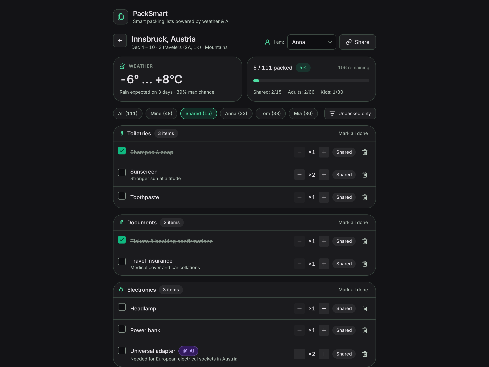
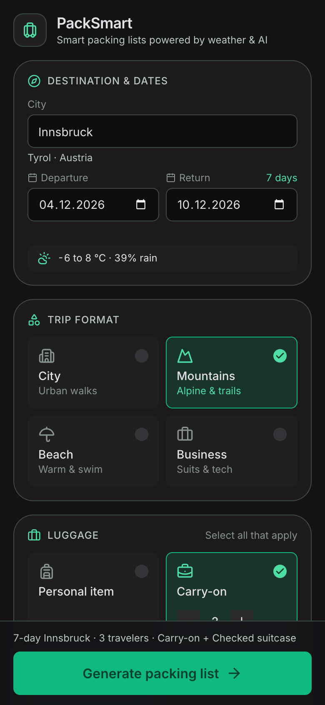
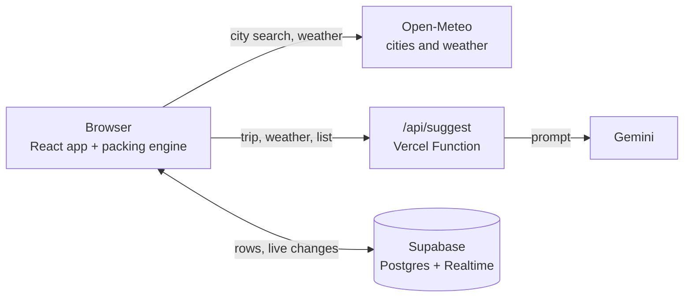

# PackSmart

**Weather-aware packing lists for the whole family, with AI extras and live sync.**


### [Live demo: packsmart-iota.vercel.app](https://packsmart-iota.vercel.app)

No sign-up. Pick a city and dates, then share the link with whoever is coming.

<p align="center">
  
  
</p>

What you need to pack depends on the weather, the kind of trip, the bags you take and who is coming. PackSmart turns those answers into one list that everyone can tick off together.

- **Rules first, AI second.** Deterministic rules build the list without waiting for AI. AI only adds extras, so the app still works when AI doesn't.
- **Live sync.** Changes show up on other devices through Supabase Realtime, and late or out-of-order responses don't undo newer ones.
- **Tested and validated.** External data is parsed with Zod, backed by 1,100+ Vitest tests.
- **Built with Claude Code,** using project-specific [agents, hooks and permissions](#built-with-claude-code).

**Contents:** [Features](#features) · [How it works](#how-it-works) · [Tech stack](#tech-stack) · [Project structure](#project-structure) · [Run locally](#run-locally) · [Deploy](#deploy) · [Sync & storage](#sync--storage) · [Data access & security](#data-access--security) · [Built with Claude Code](#built-with-claude-code) · [What Claude Code caught](#what-claude-code-caught) · [Known limits](#known-limits) · [Author](#author)

## Features

**Planning a trip**

- Search for a city, pick dates and preview the weather before generating anything.
- Four trip types: city, mountains, beach and business.
- Count your bags: personal items, carry-ons and checked suitcases.
- Add adults and kids, rename them, and leave notes for the AI.

**The packing list**

- Items follow the forecast, and many say why ("Lows down to -6°C").
- Quantities follow trip length and bag space.
- Shared and per-traveler items, grouped by category, with a progress bar.
- Pick who you are ("I am"), then filter by Mine, Shared, any traveler or Unpacked only.
- Check off, change quantities, delete, quick-add, or mark a whole category done.

**AI extras**

- Gemini suggests up to 15 items for the destination, season and your notes. Each gets an **AI** badge.
- Suggestions that repeat something already on the list, synonyms included, are dropped.
- If AI is unavailable, the rules list stays and a **Retry** button appears.

**Sharing**

- **Share** copies the trip link. Ticks, quantity changes, additions and deletions reach every open screen without a reload.
- **Recent trips** on the home page brings you back to earlier lists.
- Mobile-first layout, from 390 px phones to desktop.

### How the weather shapes the list

| Condition | When it applies | Examples of what it adds |
| --- | --- | --- |
| Rain | Any day with at least 1 mm or a 50% chance, on a trip whose warmest high is above 0 °C | Rain jacket, umbrella, rain trousers in the mountains |
| Cool | Lowest temperature above 8 °C, up to 15 °C | Light jacket |
| Cold | Low of 8 °C or below | Warm jacket, lip balm, a sweater (or gloves and a warm hat in the mountains) |
| Freezing | Low of 0 °C or below | Scarf, warm socks, thermal layer, gloves, warm hat |
| Heat | High of 27 °C or above | Sunscreen, sunglasses, cap, hand sanitizer |

The weather comes from the best source available:

1. A real forecast, if the trip ends within 15 days.
2. Otherwise, an average of the same dates over the last 3 years, labeled as a seasonal estimate.
3. If both fail, a built-in climate table, so you always get a list.

## How it works



1. You describe the trip. The browser asks Open-Meteo for the weather.
2. The engine turns trip and weather into a list, with no AI involved.
3. The trip and its items are saved to Supabase, and the list is on screen.
4. In the background, `/api/suggest` validates the request, asks Gemini for extras and validates the answer.
5. The browser merges the suggestions into the list and saves only the new rows.
6. Realtime sends item changes to everyone else viewing the trip.

### Design decisions

**The packing engine is pure.** `src/engine/` has no React, network or Supabase imports, and ESLint enforces that. The same trip and weather always produce the same list. More than 700 tests cover the engine and run in under a second. The API function reuses its Zod schemas, so browser and server agree on the data shape.

**External data is never trusted.** Zod parses Open-Meteo and Gemini responses, the `/api/suggest` request and reply, Supabase rows and the data saved in `localStorage`.

**The model doesn't get the last word.** After Gemini answers, plain code drops duplicates, fixes who an item belongs to (no phone pouch for a toddler, one health kit for the group) and caps per-person quantities at 3.

**Outside services are allowed to fail.**

| If this fails | The app does this |
| --- | --- |
| Weather forecast | Falls back to past years, then to the climate table |
| Gemini (8 s timeout, one retry on 429 or 503) | Keeps the rules list and offers Retry |
| Saving a change | Reloads the list and says it couldn't save |

**Sync is careful about order.** Each write sends only the column it changed. A fetch that arrives late is discarded, changes made while a fetch is running are replayed on top of it, and the echo of your own older write doesn't undo a newer click. If two people change the same field of the same item, the last write wins.

## Tech stack

| Layer | Choice | Used for |
| --- | --- | --- |
| UI | React 19, TypeScript, React Router | Single-page app with two pages |
| Build | Vite | Dev server and production build |
| Styling | Tailwind CSS v4, Lucide icons | One set of color tokens in `@theme` |
| State | Zustand | Trip data and per-browser preferences |
| Validation | Zod | Runtime checks and TypeScript types from one schema |
| Data | Supabase | Postgres storage and Realtime sync |
| Server | Vercel Functions on Node 22 | Keeps the Gemini key off the client |
| AI | Gemini (`gemini-3.5-flash-lite`) | Extra suggestions as structured JSON |
| Weather | Open-Meteo | City search, forecast and history, with no API key |
| Quality | Vitest, ESLint, `tsc` | Tests, layer and style rules, type checks |

## Project structure

```text
api/                  Vercel Function /api/suggest and the Gemini client
src/
  engine/             Pure packing logic: rules, quantities, merging, schemas
  services/           Open-Meteo, Supabase and /api/suggest clients
  store/              Zustand store: saving, loading, sync
  lib/                Formatting helpers and generated database types
  components/         Atomic Design: atoms, molecules, organisms, layout
  pages/              Home (new trip) and Trip (the list)
supabase/migrations/  Database schema and access policies
scripts/              Live check of the AI pipeline
.claude/              Claude Code agents, skills, commands, hooks, permissions
```

## Run locally

You need Node 22, a [Supabase](https://supabase.com) project, a [Gemini API key](https://aistudio.google.com/apikey) and, for the full app, the [Vercel CLI](https://vercel.com/docs/cli).

```bash
git clone https://github.com/VladyslavL02/packsmart.git
cd packsmart
npm install
```

**1. Set up the database.** Run [`supabase/migrations/0001_init.sql`](supabase/migrations/0001_init.sql) in the Supabase SQL Editor.

**2. Add the environment variables** to `.env.local` (git ignores it):

| Name | What it is | Reaches the browser? |
| --- | --- | --- |
| `VITE_SUPABASE_URL` | Project URL, without `/rest/v1` | Yes |
| `VITE_SUPABASE_ANON_KEY` | The anon (public) key | Yes |
| `GEMINI_API_KEY` | Gemini key, used only by `api/suggest.ts` | No |

**3. Start the app.**

```bash
vercel dev    # full app, including /api/suggest, on http://localhost:3000
npm run dev   # Vite only: no /api, so you get a Retry button instead of AI items
```

| Command | What it does |
| --- | --- |
| `npm test` | Runs the Vitest suite |
| `npm run typecheck` | Type-checks the project |
| `npm run lint` / `npm run lint:fix` | Checks (or fixes) style and layer rules |
| `npm run build` | Type-checks and builds for production |
| `npm run check:ai` | Live check against real Gemini and Open-Meteo. Needs `vercel dev` (or `LIVE_CHECK_URL`) and uses Gemini quota |

## Deploy

1. **Import the repo into Vercel** with the Vite preset. [`vercel.json`](vercel.json) rewrites app routes to `index.html`, so reloading `/trip/<id>` works.
2. **Add the three environment variables** for Production and Preview. Mark `GEMINI_API_KEY` as sensitive. The `VITE_*` values are baked in at build time, so redeploy after changing them.
3. **Branches:** `main` deploys to production and `develop` gets preview deployments.
4. **Rate-limit the AI route** with a Vercel Firewall custom rule: path equals `/api/suggest`, 10 requests per 60 seconds per IP, action 429.
5. **Check Supabase before sharing the link.** Free projects pause after inactivity, so restore it if needed.

## Sync & storage

Supabase is the source of truth for trips and packing items. Open tabs and other devices showing the same trip link get changes through Realtime.

Each browser keeps only its own Recent trips list, the "I am" choice and the AI suggestion status in `localStorage`, so these don't follow you to another device.

## Data access & security

> **PackSmart has no sign-in, and trips are not private.** The Supabase anon key ships in the JavaScript bundle and the database policies allow everything, so anyone with that key can read, edit or delete every trip, with or without its link. Don't put anything sensitive in a trip.

A trip's link contains a random uuid. That keeps other trips from showing up in the app, but it is not access control.

- Row Level Security is on for `trips` and `packing_items`. The policies for the `anon` and `authenticated` roles are `using (true)` / `with check (true)` on purpose.
- The browser only ever uses the Supabase **anon** key. No service-role key is used in client code.
- Realtime is enabled on `packing_items` (`replica identity full`), which is what keeps two open tabs of the same trip in sync. Delete events can't be filtered by trip and carry only the row id, so the app removes rows by id and ignores ids it doesn't know.
- The Gemini key stays on the server. Each Gemini call logs one line with its outcome and timing, never the key.
- `/api/suggest` validates every request and caps the text and list lengths that reach the prompt.
- The code itself does not rate limit. Add the Vercel Firewall rule described in [Deploy](#deploy).
- Traveler notes are sent to Gemini fenced off as data, not instructions, and the answer is validated like any other input.
- The schema lives in `supabase/migrations/0001_init.sql`. Regenerate `src/lib/database.types.ts` after any schema change.

## Built with Claude Code

I built PackSmart with [Claude Code](https://claude.com/claude-code), and I set up the project so that checks are part of the workflow, not something to remember. The whole setup is in this repo: [`CLAUDE.md`](CLAUDE.md), [`.claude/`](.claude) and [`.mcp.json`](.mcp.json).

**The usual loop:**

> **Plan** (I approve it) → **tests first** → **build**, with a post-edit hook → **review** agents and browser QA → **`change-verifier`** → **commit** on `develop`
>
> If the verifier rejects the change, it goes back to build.

**Agents**, each with one job. None of the reviewers has a file-editing tool.

| Agent | Job |
| --- | --- |
| [`change-verifier`](.claude/agents/change-verifier.md) | Runs the uncommitted changes to check they do what was asked |
| [`code-reviewer`](.claude/agents/code-reviewer.md) | Checks what lint can't: Zod parsing, secrets, meaningful tests |
| [`qa-auditor`](.claude/agents/qa-auditor.md) | Tests the running app in a real browser: sync, mobile layout, console errors |
| [`rules-reviewer`](.claude/agents/rules-reviewer.md) | Reads the packing lists as a traveler: missing, silly or contradictory items |
| [`service-builder`](.claude/agents/service-builder.md) | Builds typed, validated API clients with their tests |
| [`test-writer`](.claude/agents/test-writer.md) | Writes Vitest tests from a behavior spec, before the code |

**Skills and commands** for repeated work.

| Name | Job |
| --- | --- |
| [`/phase-check`](.claude/skills/phase-check/SKILL.md) | Typecheck, tests, lint and Supabase security advisors, ending in READY or NOT READY |
| [`/add-trip-preset`](.claude/skills/add-trip-preset/SKILL.md) | Adds a new trip type end to end: types, rules, test and picker card |
| [`/devlog`](.claude/commands/devlog.md) | Records what broke, what caught it and how it was fixed |

**Hooks** that run automatically.

| Hook | Job |
| --- | --- |
| [`block-env.sh`](.claude/hooks/block-env.sh) | Blocks reads and shell commands that mention env files |
| [`post-edit-check.sh`](.claude/hooks/post-edit-check.sh) | After each TypeScript edit: ESLint fix, typecheck, and engine tests for engine files |
| [`require-verified.sh`](.claude/hooks/require-verified.sh) | Blocks Claude Code's `git commit` until `change-verifier` has approved that exact diff |

**MCP servers and guardrails**

| Tool | Job |
| --- | --- |
| Playwright MCP | Drives a real browser for QA and for the screenshots above |
| Supabase MCP (read-only) | Inspects the schema and runs security advisors |
| [Permission deny list](.claude/settings.json) | Refuses common forms of risky actions: pushing to `main`, force pushing, `rm -rf`, reading env files |
| [`CLAUDE.md`](CLAUDE.md) + ESLint | Project conventions, with the mechanical ones enforced by lint |

## What Claude Code caught

I logged friction while building. Of 97 entries, 29 were first raised by a review agent, 5 by Playwright browser runs and 34 by manual review. Five that mattered:

| What broke | Caught by | Fix |
| --- | --- | --- |
| A tab holding an older copy overwrote a check-off made in another tab | `qa-auditor` | Fixed in the planned move to Supabase as the source of truth ([`69f28b0`](https://github.com/VladyslavL02/packsmart/commit/69f28b0)) |
| An older response arriving late undid newer ticks and brought back deleted rows | `change-verifier` | Number each fetch and discard stale results ([`cf6dade`](https://github.com/VladyslavL02/packsmart/commit/cf6dade)) |
| A malformed API key could end up in the server log through an error message | `code-reviewer` | Log only the error name ([`d1bba41`](https://github.com/VladyslavL02/packsmart/commit/d1bba41)) |
| Mountain trips had no daypack, and trips that never thawed still packed rain gear | `rules-reviewer` | Added the daypack and fixed the rain condition ([`d0d1b20`](https://github.com/VladyslavL02/packsmart/commit/d0d1b20)) |
| Visiting `/trip/constructor` crashed the page | `change-verifier` | Check own properties only ([`7132ffe`](https://github.com/VladyslavL02/packsmart/commit/7132ffe)) |

Several of these got past a green test suite, which is why it pays to have a second reviewer check the work and not just the tests.

## Known limits

- **Trips are not private** (see [Data access & security](#data-access--security)). Fixing this means adding sign-in, even anonymous, and member-scoped policies.
- Two tabs pressing Retry at once can add duplicate AI items. Delete the extra ones.
- Retry compares only against items still on the list, so a deleted AI item can be suggested again.
- Offline edits are not queued. If a save fails, the app tries to reload the list and shows "Couldn't save".
- Ticking or deleting an item immediately after quick-adding it can be lost.
- Recent trips, "I am" and AI status are per browser.
- Rain and snow aren't told apart. Cold days with snow can read as rain, and trips that never rise above 0 °C get no rain gear.
- A list is built once, when the trip is created. It doesn't change if the forecast does.
- The Gemini model is pinned. If it is retired, the app runs on rules alone.
- The main JavaScript chunk is over 500 kB (about 188 kB gzipped).

## Author

Built by Vladyslav · [github.com/VladyslavL02](https://github.com/VladyslavL02)
